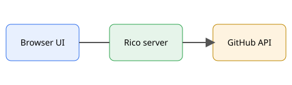

# Rico architecture

Rico lets a reviewer read the rendered markdown of a pull request and leave comments on any span
of text, including spans that cross paragraph boundaries. This document describes how the pieces
fit together and why they are shaped the way they are.

The short version: a small local server talks to GitHub, and a browser page does everything else. Nothing is stored remotely, and the GitHub token never reaches the browser.



## Goals

- Review the *rendered* document, not the raw diff.
- Let a comment cover any selection, however many blocks it spans.
- Post real pull request reviews, so teammates see them in GitHub as usual.
- Stay small: no database, no accounts, no build step.

## Non-goals

Rico does not replace GitHub's review UI for code, does not store comments of its own, and does
not try to resolve merge conflicts or render every markdown extension.

## Components

- **Browser UI** (`public/`)
  - renders markdown with source line numbers on every block
  - maps a text selection back to source lines
  - keeps queued comments in `localStorage`, per pull request and head commit
- **Server** (`server.js`)
  - holds the GitHub token
  - proxies a few REST calls
    - pull request, files and review comments
    - raw file contents and images at the head commit
    - creating a review and replying to a thread
  - refuses requests with a foreign `Host` header or without `X-Rico`
- **GitHub**
  - the only system of record

## Data flow

1. The reviewer pastes a pull request URL.
2. The server fetches the pull request, its changed markdown files, and existing review comments.
3. The browser fetches the file at the head commit and renders it.
4. The reviewer selects text and writes a comment; it is queued locally.
5. On submit, the server creates one review containing every queued comment.

## Mapping a selection to lines

Every rendered block carries `data-l="start-end"`, taken from the markdown parser's own source
map. A selection is resolved to the blocks that contain its two ends. Inside a hard-wrapped
paragraph the line is refined by counting words, because a block alone would over-select.

> Refinement only trusts the word count when the rendered text and the source agree exactly.
> Otherwise it falls back to the whole block, which is always correct but coarser.

## GitHub constraints

GitHub only accepts a review comment on a line that appears in the pull request diff, and a
multi-line comment must stay within a single hunk. Rico therefore clamps a selection to the hunk
with the most overlap and says so, and quotes the full selection in the comment body.

| Situation | Result |
|-----------|--------|
| Selection inside one hunk | Anchored exactly |
| Selection spans two hunks | Clamped to the larger overlap, quote included |
| Selection outside the diff | Added to the review summary with a quote |

## API

The browser only talks to the local server.

| Endpoint | Method | Purpose |
|----------|--------|---------|
| `/api/pr` | GET | Pull request, markdown files with patches, review comments |
| `/api/file` | GET | A file's contents at the head commit |
| `/api/raw` | GET | An image at the head commit |
| `/api/review` | POST | Create a review with inline comments |
| `/api/reply` | POST | Reply to an existing thread |

A review payload looks like this:

```json
{
  "commit_id": "<head sha>",
  "event": "COMMENT",
  "comments": [
    { "path": "docs/a.md", "start_line": 3, "line": 6, "side": "RIGHT", "body": "Tighten this." }
  ]
}
```

## Running it

```bash
export GITHUB_TOKEN=...
npm install
npm start
```

## Security

The server binds to `127.0.0.1` only. A request must carry a loopback `Host` header, which blocks
DNS rebinding, and every `POST` must send `X-Rico: 1`, which a cross-site page cannot do without
a preflight that the server never answers.

See the [glossary](reference/glossary.md) for terms used here, and [getting started](guide/quickstart.md)
for a walkthrough.
