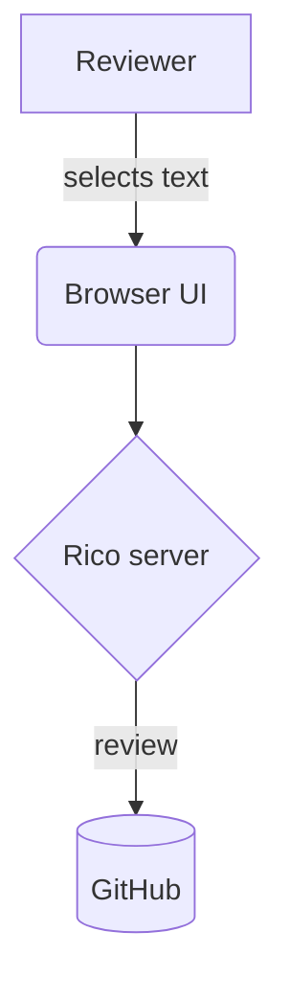
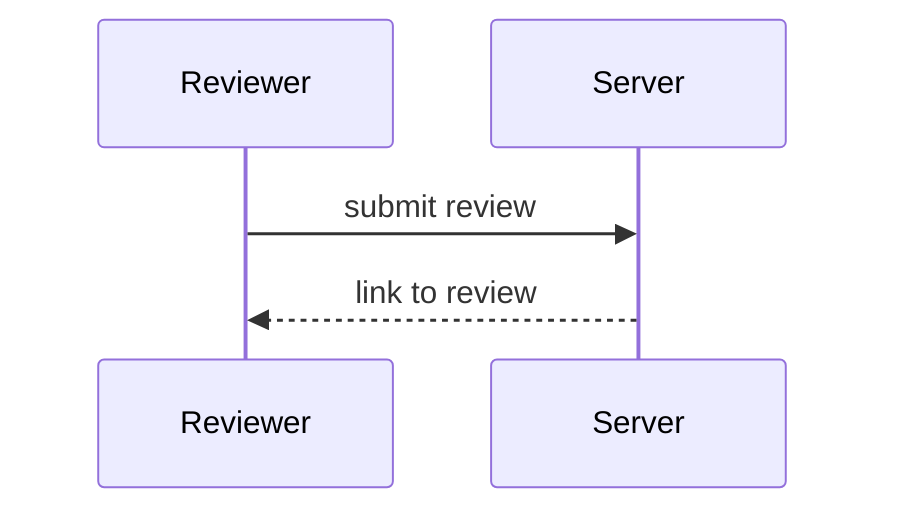

# Diagrams

How a review travels from the browser to GitHub and back.

## Request flow

```d2
direction: right
browser: Browser UI
server: Rico server {
  token: GitHub token
  proxy: API proxy
}
github: GitHub API
browser -> server.proxy: select text, comment
server.proxy -> github: create review
server.token -> server.proxy
```

The token never leaves the server.

## A diagram that does not compile

```d2
reviewer -> {
```

## Untrusted diagram source

This block carries a `javascript:` link and an icon on another host. Neither should do anything.

```d2
x: {link: "javascript:window.__pwned = 1"; icon: https://icons.terrastruct.com/essentials%2F092-graph%20bar.svg}
x -> y: harmless
```

That is all.

## Mermaid flow




