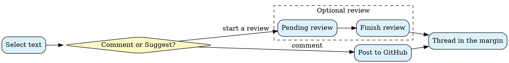
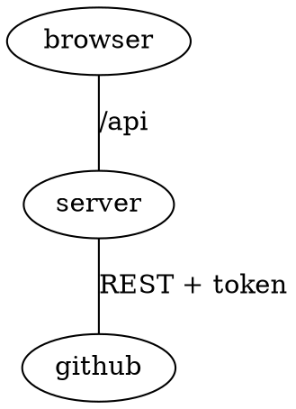

# Getting started

This guide walks through reviewing a pull request with Rico.

## 1. Start the server

Run `npm start` and open http://localhost:4317. Rico reads your token from `GITHUB_TOKEN`, or from
`gh auth token` if you are logged in with the GitHub CLI.

## 2. Load a pull request

Paste a link such as `https://github.com/owner/repo/pull/123`, or the short form `owner/repo#123`.
Rico lists the markdown files the pull request changes.

## 3. Comment

Select any text, then pick an icon under it: one comments, the other suggests an edit. The box opens in the margin beside the text. Press Ctrl+Enter to add the comment to your review.

## How a comment travels

The same idea written with the `graphviz` fence name:

## 4. Submit

Choose Comment, Approve or Request changes, and submit. All queued comments are posted as one review.
