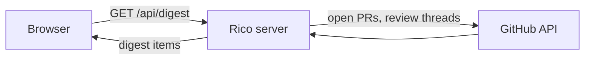

# Implementation Plan: Review digest

**Branch**: `001-review-digest` | **Date**: 2026-11-27 | **Spec**: [spec.md](./spec.md)
**Input**: Feature specification from `/specs/001-review-digest/spec.md`

## Summary

Give a signed-in reviewer one list of the review threads that are waiting on them (FR-001), grouped by pull request (FR-002), with the threads whose text changed marked (FR-003). The server reads the threads from GitHub when asked and keeps none of the text (FR-005). The page shows the list in the toolbar and remembers excluded repositories in the browser (FR-004).

## Technical Context

**Language/Version**: JavaScript, Node 22 on the server, ES modules in the browser
**Primary Dependencies**: none new (the existing GitHub client in `src/github.js`)
**Storage**: browser `localStorage` for exclusions; or [NEEDS CLARIFICATION: keep exclusions per account in KV so they follow the reviewer between browsers?]
**Testing**: `node:test` for logic and server routes, Playwright for the page, both against the fake GitHub
**Target Platform**: Cloudflare Workers (hosted) and a local Node server
**Project Type**: web application (one server, one static page)
**Performance Goals**: the digest answers in under three seconds for twenty open pull requests (SC-002)
**Constraints**: no comment text stored (FR-005); GraphQL may be unavailable, so a REST fallback is required (constitution V)
**Scale/Scope**: one reviewer at a time; tens of pull requests

## Constitution Check

*GATE: Must pass before Phase 0 research. Re-check after Phase 1 design.*

| Principle | Status | Notes |
|-----------|--------|-------|
| I. The browser never holds a secret | Pass | The digest route runs on the server with the session's token |
| II. GitHub is the system of record | Pass | Threads are read on request and not stored (FR-005) |
| III. Test first | Pass | Tasks T005 and T006 come before the code they test |
| IV. Few dependencies | Pass | None added |
| V. Every feature has a fallback | Pass | Without GraphQL the list is built from REST review comments, without resolved state (see research.md) |

## Data flow



## Project Structure

### Documentation (this feature)

```text
specs/001-review-digest/
├── plan.md
├── research.md
├── data-model.md
├── quickstart.md
├── contracts/
│   └── digest-api.yaml
└── tasks.md
```

### Source Code (repository root)

```text
src/
├── github.js        # the /api/digest route
└── digest.js        # grouping and "text changed" (pure)
public/
├── app.js           # the toolbar list
└── lib.js
test/
├── digest.test.js
└── server.test.js
e2e/
└── digest.mjs
```

**Structure Decision**: the logic that decides what is "waiting on you" is pure and lives in `src/digest.js` so the server route and the page share it.

## Complexity Tracking

No constitution violations to justify.
