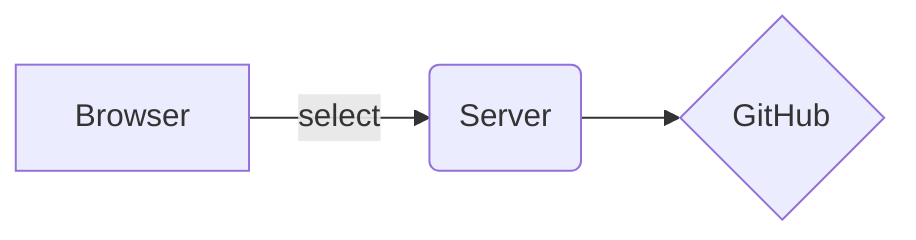
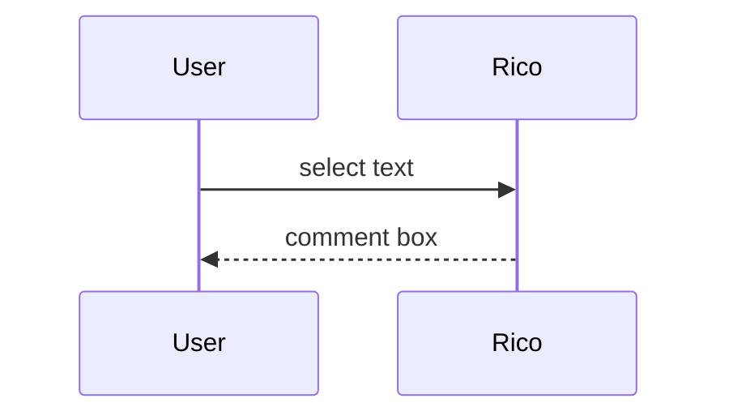
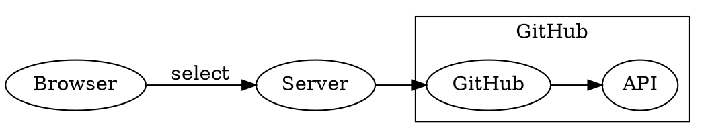
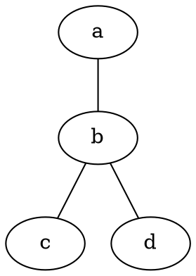

# Diagrams

An intro paragraph before the first diagram.

```d2
browser -> server: request
server -> github: api call
```

Text between diagrams.

```d2
a -> {
```

```d2
x: {link: "javascript:window.__pwned = 1"; icon: https://icons.terrastruct.com/essentials%2F092-graph%20bar.svg}
x -> y
```

A closing paragraph after the diagrams.

## Mermaid





```mermaid
flowchart LR
  A -->
```

## Graphviz





```dot
digraph { a -> }
```
